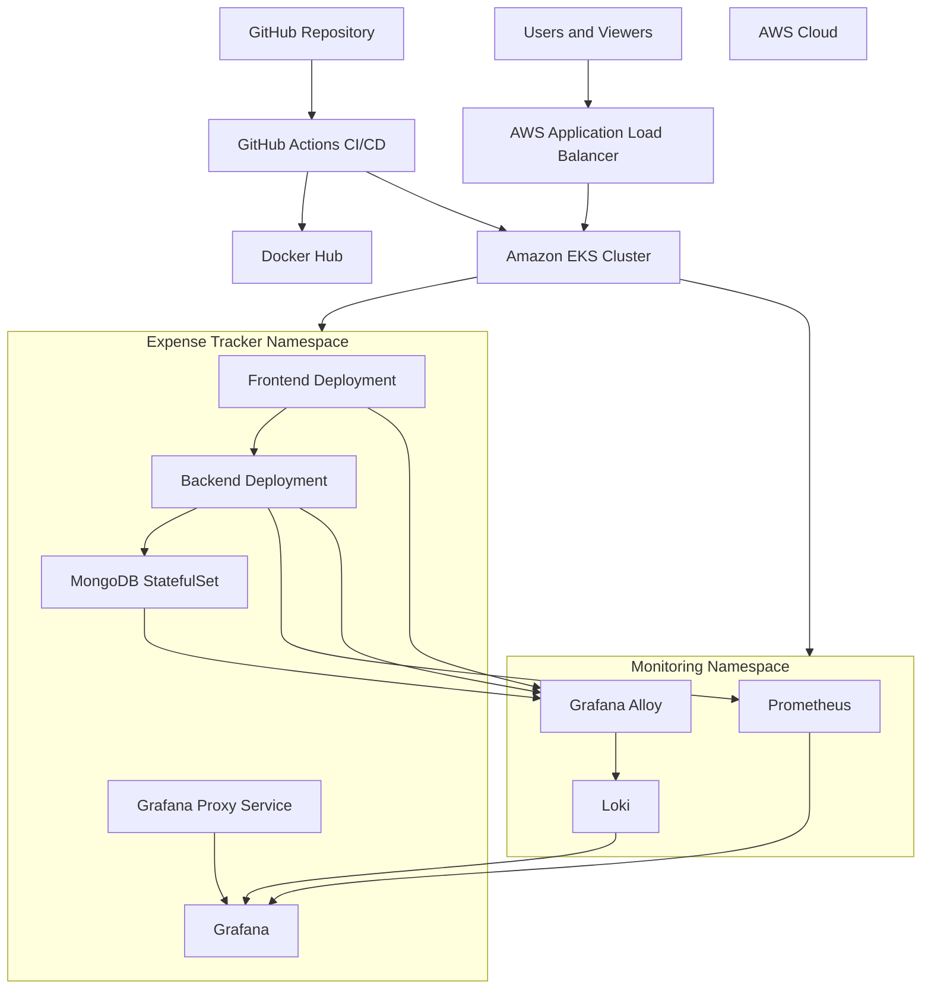

# Expense Tracker — DevOps Project

A containerised Expense Tracker application deployed on **Amazon EKS**, with automated CI/CD, infrastructure provisioning through Terraform, and centralised monitoring and logging using Prometheus, Grafana, Loki, and Grafana Alloy.

The project demonstrates the implementation of a cloud-native application deployment workflow, from containerisation and infrastructure provisioning to automated deployments, monitoring, and log analysis.

## Project Overview

The Expense Tracker is a three-tier application consisting of:

- **Frontend:** React application.
- **Backend:** Node.js and Express API.
- **Database:** MongoDB.

The application runs on Amazon EKS. AWS Application Load Balancer (ALB) provides external HTTPS access, while Kubernetes Services facilitate communication between application components.

The monitoring stack collects application metrics and centralises container logs for inspection through Grafana.

## Architecture



## Technology Stack

| Category | Technology |
|---|---|
| Frontend | React |
| Backend | Node.js, Express |
| Database | MongoDB |
| Containers | Docker |
| Container orchestration | Kubernetes |
| Cloud platform | AWS |
| Managed Kubernetes | Amazon EKS |
| Load balancing | AWS Application Load Balancer |
| Infrastructure as Code | Terraform |
| CI/CD | GitHub Actions |
| Container registry | Docker Hub |
| Vulnerability scanning | Trivy |
| Metrics monitoring | Prometheus |
| Monitoring dashboards | Grafana |
| Log aggregation | Loki |
| Log collection | Grafana Alloy |
| Version control | Git and GitHub |

## AWS Infrastructure

The project uses AWS infrastructure to host and expose the application.

Key components include:

- Amazon EKS for Kubernetes orchestration.
- An AWS VPC with public and private networking components.
- Kubernetes worker nodes running application and monitoring workloads.
- AWS Application Load Balancer for external application access.
- AWS Certificate Manager for HTTPS.
- Amazon S3 for Terraform remote state storage.

The infrastructure is provisioned and managed using Terraform.

## Application Deployment

The application runs in the `expense-tracker` Kubernetes namespace.

| Component | Kubernetes resource or service |
|---|---|
| Frontend | Frontend Deployment |
| Backend API | Backend Deployment |
| Database | MongoDB StatefulSet |
| Frontend access | `expense-frontend-service` |
| Backend access | `backend-service` |
| Grafana proxy | `grafana-proxy-service` |

The application currently uses three frontend replicas and three backend replicas, with a single MongoDB StatefulSet replica.

The backend exposes health-check and monitoring endpoints:

- `/health` — application health check.
- `/ready` — readiness check.
- `/metrics` — Prometheus metrics.

## CI/CD Pipeline

GitHub Actions automates the application build, security scanning, image publishing, and deployment process.

The pipeline includes:

1. Triggering workflows for pushes and pull requests targeting the `main` branch.
2. Installing application dependencies and running configured tests or build checks.
3. Building frontend and backend Docker images.
4. Scanning images for HIGH and CRITICAL vulnerabilities using Trivy.
5. Publishing versioned images to Docker Hub when changes are pushed to `main`.
6. Configuring access to the Amazon EKS cluster.
7. Updating Kubernetes deployment images and applying the relevant application manifests.
8. Waiting for frontend and backend rollouts to complete.

AWS and Docker Hub credentials are configured through GitHub Actions secrets rather than hard-coded into workflow files.

## Infrastructure as Code with Terraform

Terraform manages the AWS infrastructure required by the project.

Infrastructure configuration covers:

- VPC and subnet resources.
- Internet Gateway and NAT-related networking.
- Route tables.
- EKS cluster and worker-node IAM roles.
- Amazon EKS cluster.
- Managed node group.
- Terraform state stored remotely in Amazon S3.

Terraform helps make infrastructure provisioning more consistent, reproducible, and maintainable.

## Monitoring and Observability

The project includes a monitoring and logging stack deployed on Kubernetes.

### Prometheus

Prometheus collects application metrics, including HTTP request metrics exposed by the backend API. The metrics support monitoring of request volume, request rate, response latency, and HTTP 5xx errors.

### Grafana

Grafana provides dashboards for application metrics and logs.

**Grafana URL:**  
https://expensetk.name.ng/grafana/

The Grafana interface is available through the application's HTTPS domain using the `/grafana/` path.

### Loki

Loki aggregates application container logs and makes the logs searchable through Grafana.

The Loki deployment uses persistent storage and a configured retention period of **7 days**. Loki is accessed internally by the monitoring stack rather than exposed as a separate public endpoint.

### Grafana Alloy

Grafana Alloy discovers and collects Kubernetes pod logs from the `expense-tracker` namespace and forwards the logs to Loki.

This configuration centralises logs from the application components without requiring manual access to individual pods.

### Monitoring dashboards

The project includes the following Grafana dashboards and panels:

**Expense Tracker Monitoring**
- Total HTTP requests.
- HTTP request rate.
- Average request latency.
- HTTP 5xx error rate.

**Expense Tracker – Application Logs**
- General application logs.
- Backend logs.
- Frontend logs.
- MongoDB logs.

These dashboards provide visibility into application behaviour, errors, and operational activity.

## Third-Party Grafana Viewer Access

A read-only Grafana account is available for tutors, reviewers, and other authorised viewers who need to inspect the project's monitoring dashboards and application logs.

**Access details**

- **Grafana URL:** https://expensetk.name.ng/grafana/
- **Username:** `Guest`
- **Password:** Shared privately with authorised viewers.

The Viewer account is intended for inspection of dashboards and logs rather than administrative changes to Grafana configuration.

For security, credentials should be distributed privately and should not be committed to a public GitHub repository. Access to application logs should be reviewed periodically to ensure that sensitive information is not exposed.

## Security Practices

The project incorporates several security and operational practices:

- HTTPS access through AWS Certificate Manager and the Application Load Balancer.
- Container image vulnerability scanning with Trivy.
- GitHub Actions secrets for deployment credentials.
- Kubernetes Services for internal communication between application components.
- A separate monitoring namespace.
- Internal access to Loki rather than a publicly exposed Loki endpoint.
- A read-only Grafana Viewer account for third-party inspection.
- Structured backend logging with configured redaction.

These measures provide a foundation for improving application security and operational visibility.

## Repository Structure

```text
Expense-tracker/
├── .github/
│   └── workflows/
│       └── ci-cd.yaml
├── Kubernetes/
│   ├── backend-deployment.yaml
│   ├── frontend-deployment.yaml
│   ├── expense-ingress.yaml
│   ├── backend-hpa.yaml
│   └── monitoring/
│       ├── alloy-values.yaml
│       ├── loki-values.yaml
│       └── grafana-proxy.yaml
├── Terraform/
├── backend/
├── frontend/
├── docker-compose.yml
└── README.md
```

*The structure above describes the main project components; additional files may exist in the repository.*

## Learning Outcomes

This project demonstrates practical experience with:

- Containerising a multi-tier application using Docker.
- Deploying workloads to Kubernetes.
- Provisioning AWS infrastructure with Terraform.
- Building automated CI/CD pipelines with GitHub Actions.
- Publishing and scanning Docker images.
- Deploying applications to Amazon EKS.
- Configuring external application access with an AWS Application Load Balancer.
- Monitoring application metrics with Prometheus and Grafana.
- Collecting and searching Kubernetes application logs with Loki and Grafana Alloy.
- Providing read-only dashboard access for external reviewers.

## Future Improvements

Potential improvements include:

- Multi-user authentication and role-based access within the application.
- Automated integration and end-to-end testing.
- Stronger secrets management.
- Improved log-based alerting and notification channels.
- More comprehensive monitoring of database performance and application errors.
- Automated deployment verification and rollback procedures.
- Persistent MongoDB backup and recovery procedures.

## Conclusion

The Expense Tracker project combines application development, cloud infrastructure, container orchestration, CI/CD, monitoring, and centralised logging in a practical DevOps implementation.

The project provides a foundation for further improvements in automation, reliability, security, and observability.
